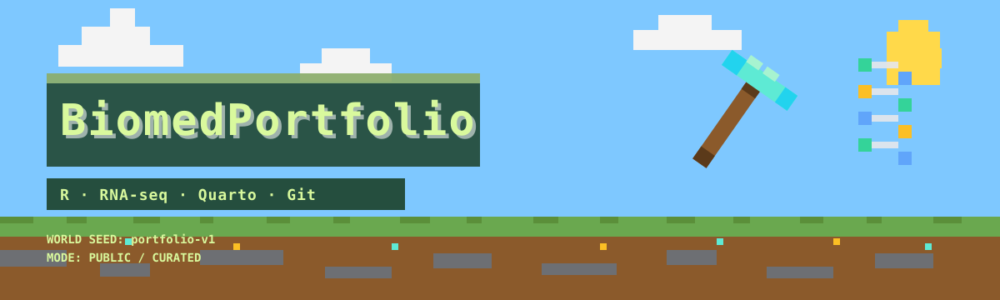
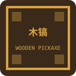
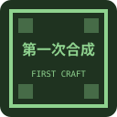
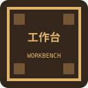

<div align="center">



# 🧬 BiomedPortfolio

**从 R 零基础到独立基因分析的项目作品集**

`R` · `RNA-seq` · `Quarto` · `Git`

<p>
  
  
  
  
  
  
</p>

> 完整学习过程在 [BiomedCraft](https://github.com/legogogoagent/biomed-quest)；这里只放完成并审查过的项目。
> Minecraft-inspired. Not affiliated with Mojang or Microsoft. 不使用官方素材。

</div>

---

## 🖥️ F3 状态栏

```text
▌ BIOMEDPORTFOLIO v0.1.0
▌ Mode      Public / Curated
▌ Projects  0 / 2
▌ Status    Boss 1 in progress
▌ Stack     R 4.5 · Quarto 1.9 · Git
▌ License   MIT + CC-BY-4.0
```

> 当前是骨架世界。第一个项目将在 Boss 1 完成后上线。

## 🗺️ 世界状态

| 阶段 | 项目 | 状态 | 掉落物 |
|---|---|---|---|
| Boss 1 | `01-airway-rnaseq` | 🚧 建设中 | 差异表达 + 富集 + 热图 |
| Boss 2 | `02-tcga-luad` | 🔒 加分项 | 肿瘤 vs 正常 + 混杂因素讨论 |
| Final | `pasilla` + portfolio | 🔒 待解锁 | 独立分析 + 公开作品集 |

## 📦 战利品表

| 稀有度 | 项目 | 问题 | 技术栈 |
|---|---|---|---|
| ★★★ | 🚧 `01-airway-rnaseq` | 气道平滑肌细胞对地塞米松的反应 | DESeq2 · clusterProfiler · ComplexHeatmap |
| ★★★★ | 🔒 `02-tcga-luad` | 肺腺癌肿瘤 vs 正常组织 | recount3 · DESeq2 · 混杂因素 |
| ★★★★★ | 🔒 `pasilla` | 在未见过的数据上独立分析 | Quarto · renv · 可复现报告 |

## 🧪 合成配方：一个作品集项目

```text
┌──────────┬──────────┬──────────┐
│ 真实问题  │ 公开数据  │ 可复现代码│
├──────────┼──────────┼──────────┤
│ 统计解释  │ 局限性    │ README    │
└──────────┴──────────┴──────────┘
                ↓
        📦 一个作品集项目
```

一个项目必须包含：

| 材料 | 说明 |
|---|---|
| 英文 README + 中文摘要 | 让不同读者都能快速理解 |
| 问题与数据 | 研究问题、样本来源、纳入标准 |
| 方法与结果 | 关键参数、图表、统计解释 |
| 局限性 | 不能说明什么、还有什么不确定 |
| 复现步骤 | `renv`、`sessionInfo()`、一键渲染 |
| 数据许可证 | 原始来源、使用限制 |

## 🎒 装备栏

这些徽章对应完成项目所需的能力，不是装饰。

| 装备 | 对应能力 | 状态 |
|---|---|---|
|  木镐 | R 基础与脚本 | 🔒 |
|  第一次合成 | `dplyr` 数据操作 | 🔒 |
|  工作台 | 可复现数据清洗 | 🔒 |
|  地图绘制者 | `ggplot2` 可视化 | 🔒 |
|  附魔台 | 统计解释 | 🔒 |
|  红石工程师 | 函数与调试 | 🔒 |

## ⚠️ 服务器规则

```text
▌ 只放完成并审查过的项目
▌ 不放大数据，只放下载脚本
▌ 不包含个人数据、密钥或受控访问数据
▌ 每个项目必须能按 README 重新跑通
▌ 数据遵循原始来源许可证
```

## 🧭 如何阅读这个仓库

| 你想看 | 去哪里 |
|---|---|
| 有哪些项目 | `projects/` |
| 怎么复现 | 每个项目的 `README.md` |
| 方法和结果 | `analysis.qmd` |
| 数据来源 | `data/README.md` |
| 环境和版本 | `sessionInfo.txt` + `renv.lock` |

## 🚀 快速开始

```bash
git clone https://github.com/legogogoagent/biomed-portfolio.git
cd biomed-portfolio
```

项目上线后：

```bash
cd projects/01-airway-rnaseq
quarto render analysis.qmd
```

## 📁 存档结构

```text
projects/
├── 01-airway-rnaseq/
│   ├── README.md
│   ├── analysis.qmd
│   ├── R/
│   ├── figures/
│   ├── data/README.md
│   └── sessionInfo.txt
└── 02-tcga-luad/
```

## 📄 License

- 代码：MIT（见 `LICENSE`）
- 文字：CC-BY-4.0（见 `LICENSE-text`）
- 数据：遵循原始来源许可证

<div align="center">

**“先把第一块石头挖下来，再谈末影龙。”**

</div>
